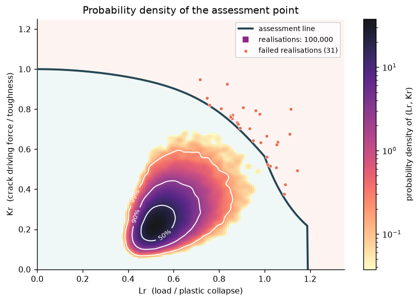
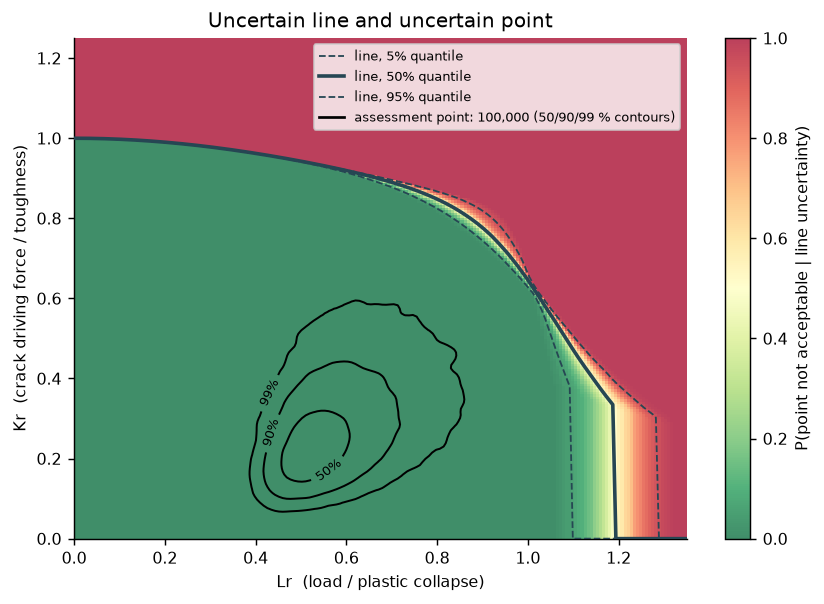
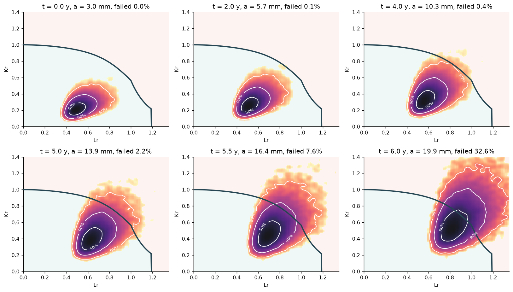

# critflaw

**Probabilistic failure assessment diagrams for flaws in metallic structures**: deterministic FAD checks,
probability-density fields on the FAD, failure probabilities with honest intervals, fatigue crack growth with
time-dependent reliability and inspection updating, an experimental WARP3D finite-element backend and an
experimental Option 3 emulator.

> [!NOTE]
> **Development has stopped.** This repository is published as it stood when work ended (October 2026), for
> reference and for anyone who wants to pick it up. It is not maintained; `docs/development/roadmap.md` lists the
> open decisions and next steps as they were left.

> [!CAUTION]
> **⚠️ RESEARCH SOFTWARE IN DEVELOPMENT. NOT VERIFIED. NOT VALIDATED. NOT FOR REAL-WORLD USE. ⚠️**
>
> critflaw has had **no independent verification or validation**. Its equations were hand-transcribed and may
> contain errors; most have not been checked against their primary references; its experimental parts failed
> their own acceptance tests. **Do not use it to make, support or check any real engineering, safety, design,
> fitness-for-service, inspection, regulatory or commercial decision.** It is not affiliated with or endorsed by
> any standards body. No warranty, no liability. Read [`DISCLAIMER.md`](DISCLAIMER.md) before going further.

<p align="center">
  
  
</p>
<p align="center">
  
</p>

## What it does

| | | status |
|---|---|---|
| **Deterministic FAD** | Option 1 and Option 2 lines, cut-off, primary and secondary stress, ρ/V interaction, direct acceptance test, radial margin, reserve factors on load and toughness, limiting flaw size | development, tested |
| **Solutions** | stress intensity and reference stress for plates (surface, through-thickness, embedded, extended flaws) and cylinders; never extrapolated outside validity | development, tested |
| **Materials** | stress–strain laws for Option 2, Master Curve, Charpy correlations | development, tested |
| **Probabilistic** | distributions, Gaussian-copula dependence, Monte Carlo with guaranteed intervals, subset simulation, importance sampling, FORM/SORM, diagnostics, implied partial factors | development, tested |
| **Fatigue and life** | crack-growth laws, spectra, breakthrough, time-dependent failure probability, inspection with probability of detection, repair | development, tested |
| **FAD graphics** | `critflaw.plot`: assessment lines, points and load rays, paths, probability-density fields with highest-density contours, exceedance fields of uncertain lines, small multiples | development, tested |
| **Audit trail** | every result carries a trace of the equations used, their primary references and their verification status; `strict=True` refuses anything below cross-checked | development, tested |
| **FE backend** | WARP3D in Docker: crack meshes, decks, runner, parser, cache, QA layers | **experimental** |
| **Option 3 emulator** | Gaussian-process emulator of deepest-point J and Pf with it (`experimental=True` required) | **experimental**, failed V10 |

"Tested" means the project's own development tests, not independent V&V (see the disclaimer).

## Install

Python 3.11+. With [uv](https://docs.astral.sh/uv/) (recommended):

```bash
git clone https://github.com/RizgarMella/critflaw.git
cd critflaw
uv sync --extra plot          # the library plus matplotlib for the FAD graphics
```

or with pip: `pip install -e ".[plot]"`.

## Quick start

```python
import numpy as np

import critflaw as cf
from critflaw import plot as fadplot, prob

plate = cf.FlatPlate(thickness=25e-3, width=0.5)                 # SI units throughout: m, Pa, Pa m^0.5
flaw = cf.SurfaceFlaw(a=3e-3, two_c=20e-3)
steel = cf.Material(355e6, 490e6, 207e9, toughness=90e6, yielding="continuous")
problem = cf.Assessment(plate, flaw, steel, cf.StressState(pm=150e6))

r = problem.run()                                                 # deterministic Option 1 check
print(r.lr, r.kr, r.acceptable, r.radial_margin)
print(cf.limiting_flaw_size(problem).value)                       # limiting depth at this shape
print(r.trace.report())                                           # equations, references, verification status

ax = fadplot.fad(problem.curve())                                 # draw the FAD and the point
fadplot.point(r, ax)

# random toughness and load: a density field on the FAD, then the failure probability
kmat = prob.LogNormal.from_mean_sd(90e6, 15e6, name="kmat")
pm = prob.Truncated(prob.Gumbel.from_mean_sd(150e6, 15e6), lo=0.0, name="pm")
pa = cf.ProbabilisticAssessment(problem.with_(material=steel.with_(toughness=kmat), loads=cf.StressState(pm=pm)))
cloud = pa.evaluate(np.random.default_rng(0).standard_normal((50_000, pa.vector.size)))
fadplot.density(cloud.lr, cloud.kr, ax)
print(pa.solve(seed=0, n_explore=20_000, replicates=4, samples_per_level=2000).summary())
```

## Start here

1. **[`examples/showcase.ipynb`](examples/showcase.ipynb)**: one notebook, stored with its figures. It covers the FAD,
   a 14 400-point acceptability map, margins, density fields, an uncertain line, fatigue trajectories, a
   population marching to the line, life-time Pf with inspection, and the audit trace. Open it locally with
   `uv run --with jupyterlab jupyter lab --ServerApp.root_dir=examples`.
2. **[`examples/19_fad_gallery`](examples/19_fad_gallery.py)**: more FAD graphics.
3. **[`examples/`](examples/README.md)**: 20 worked examples (`00`–`19`), each a script and a notebook in
   `examples/notebooks/`. `python tools/run_examples.py` runs them all.
4. **[User manual](docs/manual/user/index.md)**: installation, problem objects and units, deterministic,
   probabilistic, fatigue, cylinders, FE backend, Option 3 emulator, knowledge base, troubleshooting.
5. **[Theory manual](docs/manual/theory/index.md)**: the methods, their primary references, verification
   evidence and stated limits.

## Design rules

- Internal units are SI floats; every public numerical function accepts NumPy arrays (one call assesses
  thousands of cases).
- Problems are immutable; variants come from `.with_()`.
- Acceptance is the direct test (`Kr < f(Lr)` and `Lr < Lr,max`), never inferred from the radial margin.
- Solutions are never extrapolated outside their validity; invalid realisations are flagged, never silently
  dropped, clipped or resampled.
- Unknown values raise `NotImplementedError("TODO(verify): ...")`; nothing is invented.

## Repository layout

```
src/critflaw/        the package (fad, solutions, prob, fatigue, fe, option3, kb, plot, ...)
tests/               development tests; tests/oracles/ holds independently derived reference implementations
examples/            worked examples (percent-format scripts), notebooks/, showcase.ipynb
docs/manual/         theory and user manuals
docs/development/    how it was built, open decisions, roadmap
benchmarks/          verification scripts (outputs in benchmarks/out/)
docker/warp3d/       the WARP3D container for the experimental FE backend
tools/               example runner, notebook builders, review tooling
```

## Contributing

See [`CONTRIBUTING.md`](CONTRIBUTING.md). The project status, open decisions and next steps are in
[`docs/development/roadmap.md`](docs/development/roadmap.md). Issues and corrections are welcome, especially
reports of transcription errors against primary references.

## Citation and licence

If you refer to critflaw, cite it with the metadata in [`CITATION.cff`](CITATION.cff); cite the primary
references listed in the theory manual for the methods themselves. BSD-3-Clause ([`LICENSE`](LICENSE)); see
[`DISCLAIMER.md`](DISCLAIMER.md) for the terms of use that matter.
